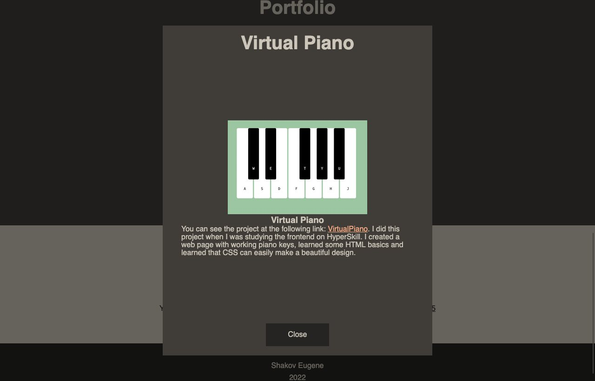

# Eugene Shakov · Front-end Portfolio

A static portfolio with an introduction, a Virtual Piano project card and contact links. HTML and CSS handle the layout, and a small JavaScript function controls the project dialog.

## Implementation guide

| File or directory | Purpose |
| --- | --- |
| [`src/index.html`](src/index.html) | Sections, project card and dialog |
| [`src/template.css`](src/template.css) | Base layout and visual styles |
| [`src/responsive.css`](src/responsive.css) | Styles for smaller screens |
| [`src/popUp.js`](src/popUp.js) | Project dialog behavior |

## Quick start

```sh
python3 -m http.server 8000 --bind 127.0.0.1 --directory src
```

Open `http://127.0.0.1:8000/`. Check the script with `node --check src/popUp.js`. If you change the dialog or grid, open the page at a desktop and a phone viewport.

## Interface



[Implementation history](https://github.com/YauheniShakau/Portfolio/commits/main/)
